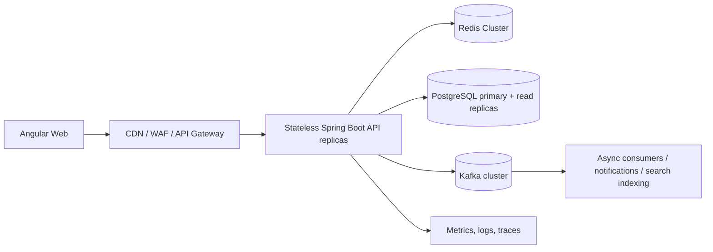

# RoomSync architecture

## Request path
1. CDN/WAF rejects abusive traffic and serves static assets.
2. API gateway performs TLS termination, coarse rate limits and routing.
3. Stateless API replicas validate bounded request DTOs.
4. Redis serves cacheable discovery reads and distributed rate-limit counters.
5. PostgreSQL is the source of truth. Transactions protect state changes.
6. Kafka carries asynchronous domain events; consumers must be idempotent.

## Matching strategy
Apply hard constraints first (budget, move-in window, location radius and non-negotiable lifestyle restrictions). Score remaining candidates using configurable weighted preferences: sleep schedule 20%, food 15%, smoking 15%, cleanliness 10%, guests/parties 10%, budget 15%, location 10%, work/study 5%. Explain each score component to users. Do not treat a weighted score as a guarantee of compatibility.

## Scale-out path
- Stateless API replicas across availability zones; autoscale on CPU, latency and queue depth.
- Redis Cluster with replicas, eviction policy selected from cache semantics, and hot-key protection.
- PostgreSQL connection pooling (PgBouncer), read replicas, partition large append-only tables, indexes verified with EXPLAIN.
- Kafka partitioning by aggregate/user key; consumer groups; retry topics and DLQ.
- CDN for images/static content; object storage for uploads; never proxy large media through API nodes.
- Search service (OpenSearch) can be introduced for geo/text discovery; PostgreSQL remains canonical.
- Regional isolation/cell architecture for very high scale; avoid a single global hot database.

## 1M RPS is a measured target
Define read/write mix, p95/p99 latency, availability, payload sizes and geographic distribution first. Run staged tests (1k, 10k, 50k, 100k+ RPS), inspect saturation and cost, then extrapolate cautiously. A 1M RPS system likely requires many API replicas and distributed cache/search infrastructure. This starter is not certified at that scale.
